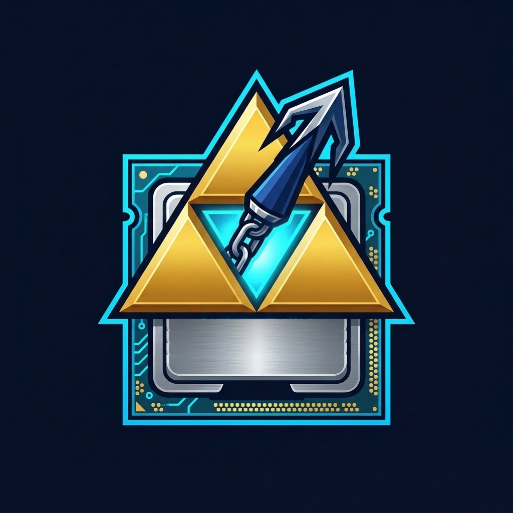

<h1 align="center">
   
  
   
  <b>Xeonshot — 2.0-rt</b>
   
</h1>

<h4 align="center">
  Recompilação nativa para Windows otimizada para plataformas "Xeon Bomba" — branch 2.0-rt sobre a base do Longshot (Rust builder &amp; RomFS direto do .nup). 
  Native Windows recompilation optimized for "Xeon Bomba" platforms — 2.0-rt branch built atop Longshot (Rust builder &amp; RomFS directly from .nup).
</h4>

  <a href="#português-brasil"><b>Português (Brasil)</b></a> ·
  <a href="#english"><b>English</b></a> ·
  <a href="https://github.com/LwkasG/Xeonshot/releases/tag/v2.0-rt-nightly"><b>Download (v2.0-rt-nightly)</b></a> ·
  <a href="#license"><b>License + Credits</b></a>

> [!IMPORTANT]
> Este repositório **não contém o jogo, chaves ou um executável pronto**. Você precisa da sua própria cópia do jogo. Tudo o que o builder gera (`xeonshot.exe`, código recompilado, caches de shader e saves) vem da sua cópia e permanece exclusivamente no seu PC. Nunca compartilhe esses arquivos.
>
> This repository **does not contain the game, keys or an executable**. You need your own copy of the game; everything the build creates stays on your PC.

## Instalar e jogar / Install and play

### [🪟 &nbsp;Download for Windows](https://github.com/LwkasG/Xeonshot/releases/download/v2.0-rt-nightly/Xeonshot-2.0-rt-Windows-x64.exe)

### [🐧 &nbsp;Download for Linux](https://github.com/LwkasG/Xeonshot/releases/download/v2.0-rt-nightly/Xeonshot-2.0-rt-Linux-x64)

Links diretos para o download da build mais recente (`v2.0-rt-nightly`) · [Ver todos os arquivos e SHA-256](https://github.com/LwkasG/Xeonshot/releases/tag/v2.0-rt-nightly) · [Versão estável 1.x (branch `main`)](https://github.com/LwkasG/Xeonshot/tree/main).

---

# Português (Brasil)

**Xeonshot** é um fork focado em **estabilidade, compatibilidade, menor consumo de RAM e redução de stuttering no Windows** em kits X99 com processadores **Intel Xeon E5 v3/v4 (Haswell-EP / Broadwell-EP)** (muitos núcleos, clock single-core moderado e memória multi-canal), sem abrir mão da fidelidade visual e de Frame Generation.

A branch experimental **`2.0-rt`** combina a base técnica mais recente do **[Longshot](https://git.magicbean.dev/MagicBeanDev/Longshot)** (continuação do **[Hookshot](https://github.com/NotRexed/Hookshot)**) com o novo builder/recompilador em **Rust** (leitura do RomFS direto do `.nup`, pasta de jogo muito menor e pipeline Vulkan atualizado) e os recursos/otimizações específicos do **Xeonshot**:

### O que a branch `2.0-rt` traz do Xeonshot
- **Large Pages de 2 MB no heap (`HOS_LARGE_HEAP_MB`):** alocação direcionada em páginas de 2 MB no Windows para reduzir pressão de TLB em CPUs Xeon E5 v3/v4.
- **`OotBarrier` otimizado (`HOS_OOT_BARRIER_SPIN_US`):** pré-spin configurável antes de ceder ao sistema operacional para reduzir contenção de barramento/locks em CPUs multi-socket/dual-ring.
- **Redução agressiva de Working Set no Windows:** suporte a `RX_VK_DROP_MODULES`, reserva inteligente sob pressão de memória (`RX_VK_AVAIL_RESERVE_MB`) e `HOS_COLD_TRIM`.
- **Menos travadinhas no caminho quente de shaders (`gpu/vk/vk_shader.cpp`):** evita executar `LowerToMaxwell` quando o programa já está no cache pré-compilado (`stage_heads_of`) e aplica cache thread-local (`prog_fast` + `picks`) para **Mesh Shaders**.
- **Identidade visual e splash animado a 60 FPS:** splash de carregamento animado do Xeonshot (`assets/xeonshot_splash_loop.png`) e curiosidades durante a preparação.

---

# English

**Xeonshot** is a fork focused on **Windows stability, lower RAM footprint, and reduced frame-time stuttering** on **Intel Xeon E5 v3/v4 (Haswell-EP / Broadwell-EP)** platforms.

The experimental **`2.0-rt`** branch is built on top of upstream **[Longshot](https://git.magicbean.dev/MagicBeanDev/Longshot)** (continuation of **[Hookshot](https://github.com/NotRexed/Hookshot)**) — bringing its **Rust builder/recompiler** and direct `.nup` RomFS loading — combined with Xeonshot's Windows/Xeon optimizations:

- **Targeted 2 MB Large Pages (`HOS_LARGE_HEAP_MB`)** and configurable **`OotBarrier` spin (`HOS_OOT_BARRIER_SPIN_US`)**.
- **Windows Working Set reductions:** `RX_VK_DROP_MODULES`, `RX_VK_AVAIL_RESERVE_MB`, and `HOS_COLD_TRIM`.
- **Shader lookup fast-path (`gpu/vk/vk_shader.cpp`):** skips `LowerToMaxwell` on shader cache hits (`stage_heads_of`) and caches `ProgramKind::Mesh` picks thread-locally.
- **Xeonshot animated 60 FPS splash & loading trivia.**

Nightly builds are published to the [`v2.0-rt-nightly` pre-release](https://github.com/LwkasG/Xeonshot/releases/tag/v2.0-rt-nightly). For the standalone 1.x Xeonshot release, see the [`main`](https://github.com/LwkasG/Xeonshot/tree/main) branch.

---

## Upstream Documentation & Contributing

Technical developer documentation inherited from Longshot lives in [`docs/dev/README.md`](docs/dev/README.md), [`docs/user/`](docs/user/getting-started.md), [`CONTRIBUTING.md`](CONTRIBUTING.md), and [`AGENTS.md`](AGENTS.md).

## License

Xeonshot is free software under the [GNU General Public License, version 3 or later](LICENSE) (GPL-3.0-or-later).
It is a modified derivative of [Longshot](https://git.magicbean.dev/MagicBeanDev/Longshot) and [Hookshot](https://github.com/NotRexed/Hookshot), both released under the same license; all upstream code and copyrights belong to their respective authors.

    Hookshot: Copyright (C) 2026 NotRexed and the Hookshot contributors
    Longshot: Copyright (C) 2026 the Longshot contributors
    Xeonshot: Copyright (C) 2026 LwkasG and the Xeonshot contributors

It includes code from Eden and suyu, which are under the GPL too. Third-party parts under other licenses that
work with the GPL (Sirit, the Vulkan Memory Allocator, SDL, Opus, Dear ImGui, zstd, the Libertinus fonts and zbic) keep
their own notices in their folders; TOTKPort's notice for the parts after a64-kit (host/, builder/rt) is
host/NOTICE.TOTKPort.md.

Xeonshot / Longshot is an unofficial fan project, not affiliated with or endorsed by Nintendo. The Legend of Zelda and Ocarina of
Time are trademarks of Nintendo.

## Credits

This project would not exist without **Longshot** and **Hookshot**, and the work of many contributors upstream:

- **Longshot contributors** ([git.magicbean.dev/MagicBeanDev/Longshot](https://git.magicbean.dev/MagicBeanDev/Longshot)): the Rust builder (`longshot-builder`), `.nup` RomFS support, Vulkan renderer improvements, and active upstream development.
- **NotRexed**: [Hookshot](https://github.com/NotRexed/Hookshot), which Longshot is a fork of, BlueShell (Mario Kart World),
  Skybound (Tears of the Kingdom) and the a64-kit tools (host/ and the lifter's runtime are after them).
- **[Eden](https://git.eden-emu.dev/eden-emu/eden)** and **Eglantine**: the shader recompiler and Switch 2 shader work.
- **suyu**: the graphics decoders and the AArch64 translator.
- **[seedds/nxnative](https://github.com/seedds/nxnative)**: reference for how task and mesh shaders work.
- **[EvilBoyce / evilmfkr](https://github.com/evilmfkr/Hookshot)** (EvilOOT): GPU culling for Kokiri foliage, ambient light probes, pond water, fog, Horizon mutex handoff, and exposure flicker fix.
- **[zortos293/Lichii](https://github.com/zortos293/Lichii)**: reference for Ampere shader lowering, and its compare-exchange retry fix.
- **[mstorsjo/llvm-mingw](https://github.com/mstorsjo/llvm-mingw)**: the bundled Windows compiler (no Visual Studio needed).
- **NVIDIA DLSS**: builds made with NVIDIA's DLSS SDK (optional, downloaded by each build, never bundled) use NVIDIA DLSS
  Super Resolution, NVIDIA's technology. NVIDIA and DLSS are trademarks of NVIDIA Corporation.
- **AMD FSR 3.1 and FSR 4**: every build has AMD FidelityFX Super Resolution 3.1, built from AMD's MIT-licensed FidelityFX
  SDK shaders; builds made with FSR 4 (optional; AMD's DLLs are never bundled) use AMD FidelityFX Super Resolution 4
  through AMD's MIT-licensed FSR API headers. Both are AMD's technology. AMD, Radeon and FidelityFX are trademarks of Advanced Micro
  Devices, Inc.
- **[kinnay/zbic](https://github.com/kinnay/zbic)**, **Opus** and **SDL**: decompression, audio and controllers.
- **[sostenesfreitas/ocarina-recomp](https://github.com/sostenesfreitas/ocarina-recomp)**: notes on the mesh stage control section.
- **[MythosOfs/Orchid](https://github.com/MythosOfs/Orchid)**: earlier fog and exposure workarounds.
- **Mesa (NAK)**: the reference for Ampere's instruction encoding.
- All upstream Hookshot/Longshot contributors, including: SkippySteve, monsterlag, klimovich008, hckrman101, madebyjordan, N3oTraX, shayderrr, gab9281, Wpaif, nicholasgower, ZurielAtr, Joey-Magnus, Zorkats, d3zessete, chrispository, vzeol, leonidasmark, Segmentree, ShyVortex, hiKareeem, and i900gaming, among others.
